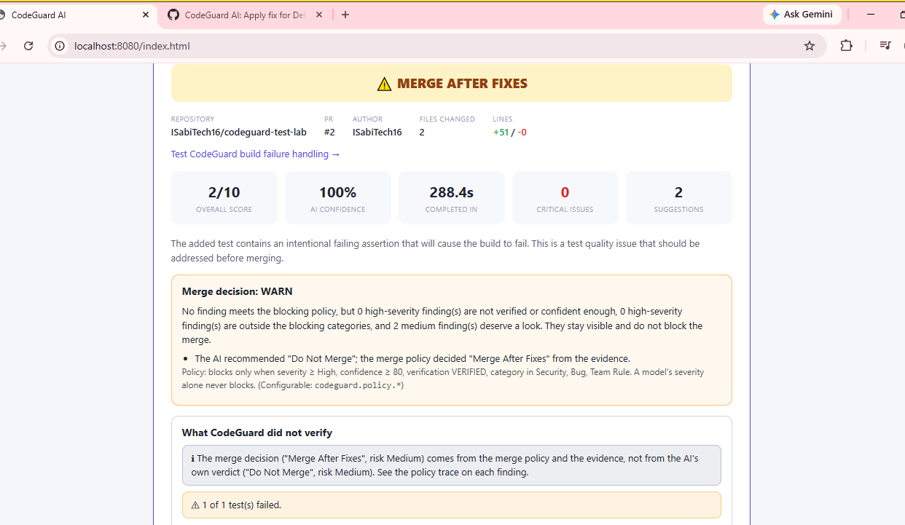
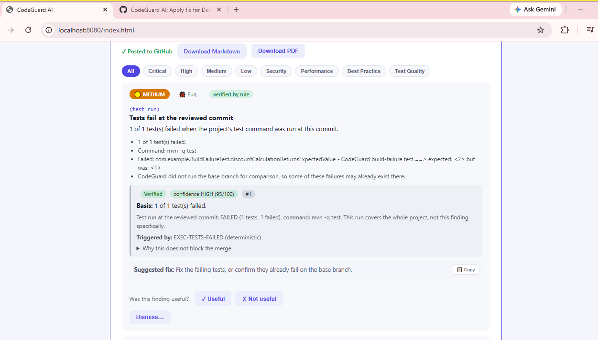
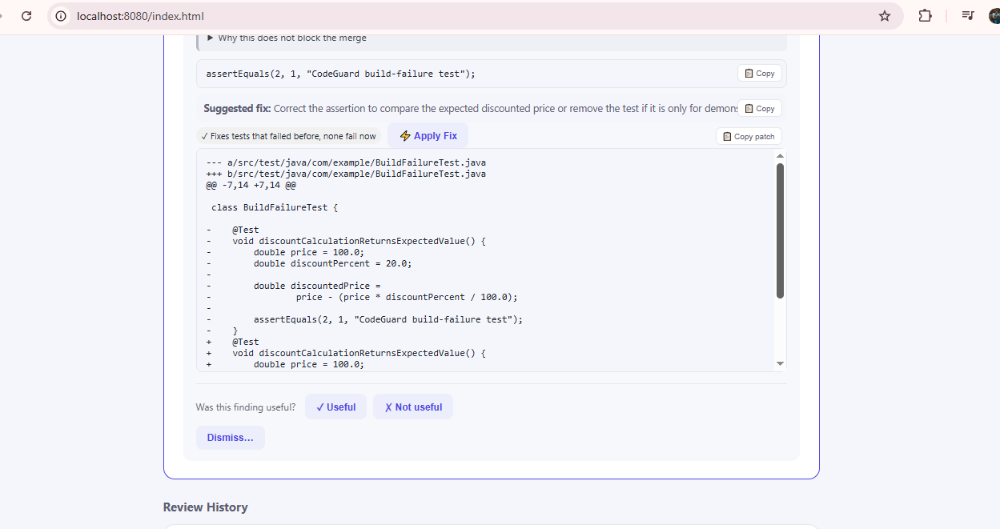
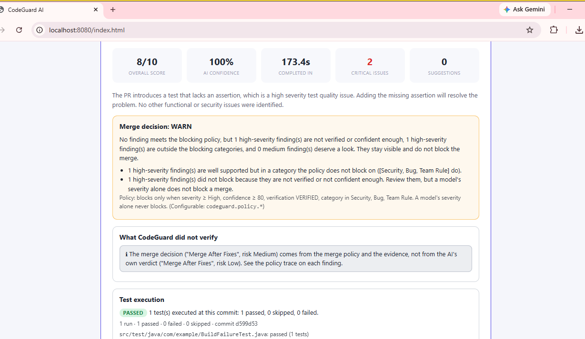
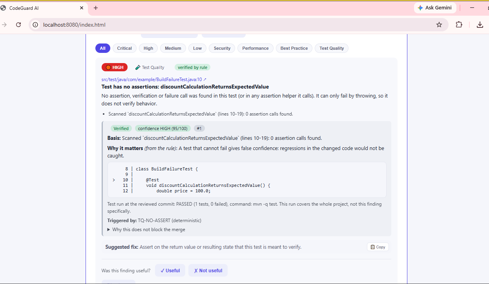

# CodeGuard AI

**Self-hosted GitHub pull-request reviewer for Java and Spring Boot that shows its evidence.**

> This repository is a **public preview** containing documentation, screenshots, and one real, independently runnable Java module with its tests. Explore the implementation and evaluate the code quality before purchasing the full application.
>
> **Get the full CodeGuard AI source code:** [Purchase on Gumroad](https://javacoder716.gumroad.com/l/codeguard-ai)

---

## What it does

CodeGuard AI connects GitHub pull requests to an AI provider of your choice (Groq, OpenAI, Gemini, or local Ollama), reviews code changes, and explains what it **verified** and what it only **inferred**.

You run it on your own infrastructure.

**Technology stack:** Java 21, Spring Boot 3.

## Evidence labels

Every finding carries one of four evidence labels:

| Label | Meaning |
|---|---|
| **Verified by rule** | A deterministic check observed the issue directly (for example, a test method with zero assertions). |
| **Rule-based heuristic** | A deterministic pattern or name-based scan detected a potential issue that should be confirmed by a human. |
| **AI finding, code located** | The AI reported an issue, and CodeGuard located the quoted snippet in the file at the reviewed commit. |
| **AI inference, unverified** | The AI reported an issue, but the quoted snippet could not be located in the source. |

Confidence is capped by evidence: an unverified AI claim cannot score above 60/100.

The merge verdict comes from a configurable policy, not from the model's confidence score.

## Demo

The following screenshots are from the running CodeGuard AI application.

### 1. Review overview



### 2. Verified test failure



### 3. Suggested Apply Fix



### 4. Review after applying the fix



### 5. Test quality detection



## What the full version includes

The complete CodeGuard AI application includes:

- GitHub webhook and API integration.
- Multi-provider AI support (Groq, OpenAI, Gemini, and Ollama).
- Evidence labels and configurable merge policies.
- Stale-review protection: each review is tied to the exact commit it analyzed.
- Test-quality analysis (empty tests, trivially true or commented-out assertions, and more).
- Deterministic checks on added lines (committed secrets, disabled TLS verification, SQL built by concatenation, and more).
- Opt-in Docker test execution with explicit statuses: `PASSED`, `FAILED`, `ERROR`, `TIMED_OUT`, `NO_TESTS_EXECUTED`, and `NOT_RUN`.
- Suggested fixes with an explicit Apply Fix step.
- Team rules and dismissal learning.
- Review history.
- Markdown and PDF export.
- Installation guide and testing guide.
- Security and data-flow documentation.
- API documentation and Postman collection.
- Database schema.

**Note:** These are full-product capabilities. This public repository does not contain the complete application source code.

## How setup works

The full CodeGuard AI application is designed to run on your own infrastructure.

A typical setup involves:

1. Installing JDK 21 and Maven.
2. Choosing a database (H2 for a quick trial or MySQL for a longer-running setup).
3. Creating a GitHub personal access token with the minimum required repository permissions.
4. Configuring an AI provider using an API key or a local Ollama model.
5. Running the Spring Boot application and opening the dashboard.
6. Connecting a repository and providing a pull request number to start a review.

A webhook is optional.

The complete installation instructions are provided with the full application.

## Where your code goes

CodeGuard runs on your infrastructure.

With Ollama, your code can remain within your own environment. If you choose OpenAI, Gemini, or Groq, the changed files and the context required for the review are sent to the selected provider, subject to that provider's terms and your configuration.

## Repository structure

```text
CodeGuard-AI/
│
├── README.md
│
├── docs/
│   └── images/
│       ├── 01-review-overview.png
│       ├── 02-verified-test-failure.png
│       ├── 03-suggested-apply-fix.png
│       ├── 04-after-apply-fix.png
│       └── 05-test-quality-detection.png
│
└── sample/
    └── test-outcome/
        ├── pom.xml
        └── src/
            ├── main/
            │   └── java/
            │       └── com/
            │           └── codeguard/
            │               ├── analysis/
            │               │   ├── TestOutcome.java
            │               │   ├── TestReportParser.java
            │               │   ├── Code.java
            │               │   └── Lang.java
            │               │
            │               └── dto/
            │                   ├── TestExecutionEvidence.java
            │                   └── PullRequestFile.java
            │
            └── test/
                └── java/
                    └── com/
                        └── codeguard/
                            └── analysis/
                                └── TestOutcomeTest.java
```

## Runnable Java sample: Test Outcome Engine

This repository includes a real sample module from CodeGuard AI.

The **Test Outcome Engine** demonstrates how CodeGuard classifies test execution results without incorrectly reporting an unverified test run as successful.

### Key capabilities demonstrated

- **Honest test classification:** A test run is marked `PASSED` only when the command exits successfully, readable results confirm execution, at least one test ran, and no failures or errors occurred.
- **Zero-test detection:** Distinguishes a successful build with zero executed tests from a genuine passing test run.
- **Failure detection:** Identifies failed tests and execution errors.
- **Timeout handling:** Reports timed-out test execution separately.
- **Changed test mapping:** Matches changed JVM test files against executed JUnit suites.
- **Console output parsing:** Demonstrates parsing of JUnit-related, Python unittest, and pytest console output.
- **Failure comparison:** Identifies tests fixed and newly broken after a patch.

### Run the sample tests

**Requirements:**
- JDK 21
- Maven

Clone the repository:

```bash
git clone https://github.com/ISabiTech16/CodeGuard-AI.git
```

Navigate to the sample module:

```bash
cd CodeGuard-AI/sample/test-outcome
```

Run the tests:

```bash
mvn clean test
```

### Verified test execution

The sample was successfully compiled and tested using Java 21 and Maven.

| Test result | Verified output |
|---|---:|
| Tests executed | 10 |
| Failures | 0 |
| Errors | 0 |
| Skipped | 0 |
| Build status | **BUILD SUCCESS** |

The test results demonstrate the behavior of the included sample module. They are not a claim about the full application's overall test coverage.

## Limitations

- AI findings and suggested fixes are advisory. Always review proposed changes before merging.
- Test-quality and impact analysis use static and name-based techniques and may miss indirect coverage.
- Docker test execution is opt-in. With network access disabled (the default), dependencies may be unavailable, resulting in an `ERROR` rather than a passing result.
- The full application has no built-in authentication. Run it behind a VPN, reverse proxy, or private network.
- CodeGuard is intended for self-hosted, single-team, private use, not as a public multi-tenant service.
- The public repository contains only the documented preview and runnable sample, not the complete application.

## Project status

- **Technology:** Java 21 and Spring Boot 3.
- **Public repository:** Documentation, screenshots, and the Test Outcome Engine sample.
- **Sample test status:** 10 tests passed, 0 failures, 0 errors.
- **Full application:** Available through the purchase link above.

## License

The sample module and documentation in this repository are provided for review only. They may not be copied, redistributed, or used commercially without permission.

The complete CodeGuard AI product is licensed under the terms provided with your purchase on Gumroad.
